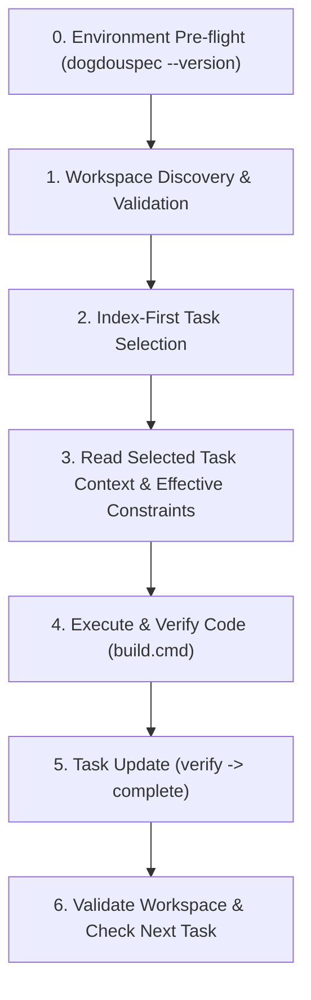

# DogdouSpec Workflow Guide

DogdouSpec is an iteration-first specification and task management system designed to keep multi-step, complex engineering tasks structured, token-efficient, and resilient across AI coding sessions. Authoritative state is stored in XML documents under `.dogdouspec/` and validated against XSD v1 schemas.

---

## 0. Post-Install Setup (Run Once After `workspace init` or After Upgrading)

`workspace init` has already performed the following mechanical steps:
- Created `.dogdouspec/` with authoritative schemas, backlog, and knowledge documents.
- Written this skill to `.agents/skills/dogdouspec/` (SKILL.md + references/).
- Recorded `.skill-state.xml` for a new Skill installation, with a sync baseline and optional history; existing or mixed installations retain their provenance.
- Added `/.dogdouspec/_tmp/` to `.gitignore`.

The following steps require **agent + owner judgment** — DogdouSpec does not automate them.

### What to Add to `AGENTS.md`

If your project does not yet have an `AGENTS.md`, create one. Add a `## DogdouSpec Workflow` section that at minimum tells agents:

1. **When to use DogdouSpec** — Mode A (direct commit) vs Mode B (governed iteration). See §1 below.
2. **CLI invocation** — global install: `dogdouspec <command>`. Air-gapped / repo-local: `.\dogdouspec.cmd <command>`.
3. **Fail-closed guard** — if `dogdouspec` is not found, stop and instruct the user to run `winget install Vixasol.DogdouSpec`.
4. **Read the checked-in skill** — point agents to `.agents/skills/dogdouspec/SKILL.md` for complete workflow rules.
5. **Never edit `.dogdouspec/*.xml` directly** — all mutations must go through the CLI.
6. **Preserve user work** — do not commit or push unless explicitly asked.
7. **Read effective constraints before execution** — after selecting or resuming a Task, run `dogdouspec task context --task "<TASK_ID>" --iteration "<ITERATION_ID>" --no-history --format xml` and read both iteration and task constraints before starting work. A raw Task query or `task show` alone omits iteration constraints.

Tailor the section to your project's build commands (e.g., replace `.\build.cmd` with `npm test`, `cargo build`, `dotnet test`, etc.).

### What to Commit to Git

| Path | Commit? | Note |
|---|:---:|---|
| `.dogdouspec/` | **Yes** | Authoritative state (backlog, knowledge, iterations, schemas) |
| `.agents/skills/dogdouspec/` | **Yes** | Skill instructions and repository-specific `.skill-state.xml` baseline/history |
| `AGENTS.md` | **Yes** | Project agent guidelines |
| `.gitignore` | **Yes** | Now includes `/.dogdouspec/_tmp/` |
| `.dogdouspec/_tmp/` | **No** | Runtime-only; already in `.gitignore` |

DogdouSpec never stages, commits, or pushes. Create the Git checkpoint explicitly after reviewing `git status --short -- .dogdouspec`.

### Upgrading DogdouSpec

After installing a new global binary or staging a vendored candidate, inspect
the status and read the new binary's focused upgrade guide:

```powershell
dogdouspec --version
dogdouspec skill status --format xml
dogdouspec schema status --format xml
dogdouspec skill guide --file references/upgrade.md
```

Follow [the authoritative upgrade contract](references/upgrade.md). Inspect the
workspace, Skill, schema copies, repository rules, and Git state before calling
any synchronization command. The CLI performs explicit mechanical operations;
the calling agent reconciles `AGENTS.md`, local guidance, scripts, CI, and other
repository-specific content. `skill sync` and `schema sync` never perform those
judgment-based edits. Upgrade conditions are advisory: `skill sync --force`
remains the caller's overwrite choice, with no mandatory customization log.

Users and agents customize Skill Markdown directly. Consider recording why and
what changed with `skill record --summary "..."`; read recent intent with
`skill records --last 5`, and inspect local-to-new content with `skill diff`.
The portable `.skill-state.xml` stores the last sync baseline and optional
history together. `record` never resets that baseline; sync preserves history.
Use `skill guide --all` only when the full guide is useful, or `skill export
--output-dir <new-directory>` to read the embedded files without console encoding.

---

## 1. Design Philosophy & When to Use DogdouSpec

### The Core Problem DogdouSpec Solves
Traditional monolithic markdown files (e.g., `TODO.md`, `PLAN.md`, `TASKS.md`) impose a severe cognitive and token burden on AI coding agents. As sessions grow, repeatedly loading and parsing large markdown task graphs causes **context drift**, **lost constraints**, **hallucinated checkboxes**, and **massive token waste**.

DogdouSpec replaces unstructured markdown tracking with **schema-validated XML artifacts, deterministic concurrency locks, and two-phase XPath queries (`ds:filter`)**, loading only the active task's minimal context (saving ~90% tokens per step) and preventing context corruption across multi-session or multi-agent handoffs.

### Two Explicit Operating Modes (Avoid False Friction)

| Mode | Applicable Scenarios | Workflow & Overhead |
|---|---|---|
| ⚡ **Mode A: Direct Execution** *(Default for Minor Work)* | Standalone bug fixes, single-file refactorings, script tweaks, typo corrections, or bounded changes completed in a single commit. | **Zero DogdouSpec Overhead**: Do **NOT** create, query, or mutate `.dogdouspec/` iterations or tasks. Make code changes directly, run tests, and record full rationale in the Git Commit Message (Title + numbered details). |
| 🛡️ **Mode B: Governed Iterations** *(Complex & Multi-Step)* | Multi-step feature roadmaps, architectural overhauls, formal spec/acceptance gating, cross-session handoffs, or multi-agent collaboration. | **Full DogdouSpec Governance**: Follow the two-phase query pattern, task state transitions (`pending` -> `in-progress` -> `verification` -> `done`), and owner confirmation gates. |

> [!IMPORTANT]
> **Anti-Pattern Guard**: Never create or mutate DogdouSpec iterations for trivial single-commit tasks. Standard Git commit messages already explain bounded changes with zero friction. Use DogdouSpec when durable iteration governance and token-efficient state tracking are truly required.

---

## 2. Core Invariants (When Using DogdouSpec)

1. **Global CLI Execution & Pre-flight**: Use the global `dogdouspec <command>`. Before running commands, verify `dogdouspec --version`. If `dogdouspec` is missing, fail closed and prompt the user to install via `winget install Vixasol.DogdouSpec`. No repository-local wrapper scripts (`dogdouspec.cmd`) or background daemons are required.
2. **Never Edit Managed XML Directly**: Never edit, write, or copy `.dogdouspec/*.xml` using text editors or scripts. All mutations must pass through the public CLI (`task update`, `task review`, `task add`, `task revise`, `task split`, `requirement propose`, `change propose`, `change apply`, `append`, `transaction apply`, `iteration confirm`).
3. **Two-Phase Query Pattern**: Query compact indexes first (`ds:filter`), then read `task context --no-history` for the selected task before execution, including both iteration and task constraints. Load additional Task details only as needed. Never load whole task graphs into context.
4. **Exact Revisions & Post-Mutation Re-Query**: Always pass exact expected revisions to mutating commands. After each mutation, validate the workspace with `dogdouspec validate` and re-query target documents.
5. **Respect Authority Boundaries**: Technical task automation never auto-completes product requirements, design decisions, acceptance criteria, or iterations. Stop and prompt the owner when product decisions are needed.
6. **Terminal Task Immutability**: Tasks in `done`, `transferred`, `superseded`, or `cancelled` statuses are immutable; low-level edits and execution transitions fail with `TASK_IMMUTABLE`. Only append-only informational records may be added.
7. **Replanning Execution Freeze**: When an iteration is in `status="replanning"`, task execution transitions (`start`, `resume`, `verify`, `complete`) fail closed with `ITERATION_REPLANNING_EXECUTION_FROZEN`. Technical planning helpers (`task add`, `task split`, `change apply`) and terminal dispositions remain enabled.
8. **Semantic Agent Results Are Iteration State**: Persist implementation summaries, changed files or commits, commands and exit codes, review disposition, findings, risks, blockers, and handoff instructions in the relevant `tasks.xml` Task records. Do not create a durable agent-report ledger or depend on `.agents/work-results/` for recovery.
9. **Raw Output Is Transient by Default**: Worker JSON/Markdown, raw prompts, chat transcripts, mutation request XML, and provider telemetry are transport or diagnostic material, not governed state. Large traces, dumps, packages, screenshots, or complete logs may remain in repository-approved artifact storage, but the Task record must preserve the semantic outcome and any required locator or digest.
10. **Checkpoint Authoritative State**: In a Git-backed Mode B workspace, validate and checkpoint managed `.dogdouspec/` documents at material lifecycle, review, handoff, external-blocker, and release boundaries. Ignore only `.dogdouspec/_tmp/`. Never stage, commit, or push without user or repository authority; if authority is absent, report the workspace as locally durable but not transport-ready and list the uncheckpointed files.

---

## 3. Standard Agent Workflow Loop (When in Mode B)



### 0. Environment Pre-flight (Discovery & Fail-Closed Guard)

Before executing DogdouSpec commands, verify that `dogdouspec` is available in PATH:

```powershell
dogdouspec --version
```

> [!IMPORTANT]
> **Fail-Closed Guard**: If `dogdouspec` is not found or fails to execute:
> 1. **STOP immediately**. Do NOT attempt to read or edit `.dogdouspec/*.xml` directly.
> 2. Output the following user instruction:
>    > ⚠️ **DogdouSpec CLI is not installed on this system.**
>    > Please install it via WinGet:
>    > ```powershell
>    > winget install Vixasol.DogdouSpec
>    > ```

### 1. Workspace Discovery & Validation

Verify workspace health and list active iterations:

```powershell
dogdouspec workspace discover --format xml
dogdouspec validate --format xml
dogdouspec iteration list --format xml
```

### 2. Index-First Task Selection (Two-Phase Query)

Use two explicit compact queries to derive the next actionable task:

1. **Resume In-Progress or Verification Task** (Highest Priority):
   ```powershell
   dogdouspec query --document "<ITERATION_ID>/tasks.xml" --xpath "ds:filter(/tasks/task[@status='in-progress' or @status='verification'][1], '@id', '@status', '@agent', 'index')" --format xml
   ```

2. **Next Ready Pending Task** (If no task is in-progress or in verification):
   ```powershell
   dogdouspec task next --iteration "<ITERATION_ID>" --format xml
   ```

   This public read-only helper is mandatory whenever the active-task query is
   empty. A pending-task XPath is document-local and cannot prove readiness for
   `depends-on` references in another iteration or document.

### 3. Read Selected Task Context & Effective Constraints (Required)

After selecting a Task, and whenever resuming it in a new session, read its bounded context before starting or continuing execution:

```powershell
dogdouspec task context --task "<TASK_ID>" --iteration "<ITERATION_ID>" --no-history --format xml
```

This essential view includes constraints from `spec.xml` with `scope="iteration"` and from the Task with `scope="task"`, preserving optional `kind`. Both scopes apply; task constraints do not override iteration constraints. Resolve conflicting constraints before execution through the appropriate technical or owner decision path. `--no-history` omits supplemental history, never effective constraints. If essential context exceeds the byte limit, increase `--max-bytes`; do not bypass a failed context query with a raw Task read.

When additional Task details or history are needed, query them separately:

```powershell
dogdouspec query --document "<ITERATION_ID>/tasks.xml" --xpath "/tasks/task[@id='<TASK_ID>']" --format xml
dogdouspec task context --task "<TASK_ID>" --iteration "<ITERATION_ID>" --max-bytes 32768 --format xml
dogdouspec task records --task "<TASK_ID>" --iteration "<ITERATION_ID>" --last 5 --kind verification --fields id,created_at,summary,checks --format xml
```

Raw Task queries and `task show` describe only `tasks.xml`; they do not replace the required context read. Identify objectives, scope includes/excludes, origin requirement, acceptance criteria, effective constraints, and previous records before modifying code. Re-read context after a constraint change before continuing work.

### 4. Technical Execution & State Transitions

#### ⚡ Fast-Path: High-Level Porcelain Commands (Zero-XML in Terminal — Recommended)

1. **Start Task** (transitions `pending` -> `in-progress`):
   ```powershell
   dogdouspec task start --task "<TASK_ID>" [--iteration "<ITERATION_ID>"] [--summary "..."] [--occurred-at <TIMESTAMP>] --format xml
   ```
2. **Implement & Build**:
   - Make necessary code and test changes.
   - Run `.\build.cmd` (or project build command) to compile and execute all tests.
   - Treat worker responses as transient transport. Summarize material implementation, verification, review, risk, and handoff facts in the Task's records using `task record`:
     ```powershell
     dogdouspec task record --task "<TASK_ID>" [--iteration "<ITERATION_ID>"] [--kind discussion|finding|verification|completion|decision] [--status informational|active|resolved] [--summary "..."] [--occurred-at <TIMESTAMP>] [--covers "<CRITERION_ID>"] --format xml
     ```
   - For command evidence, add `--check-command "dotnet test" --check-result passed --check-exit-code 0 --check-summary "Describe the observed result."`. This writes existing structured `checks` on the record; use `task records --fields id,summary,checks,covers` to read it. Evidence does not automatically accept criteria or satisfy an independent review gate.
3. **Block Task & Manage Recheck Queue** (when obstructed by external/review/dependency obstacles):
   ```powershell
   # Record structured blocker finding and transition to blocked (or pass --record-only to record finding without status change):
   dogdouspec task block --task "<TASK_ID>" [--iteration "<ITERATION_ID>"] --summary "..." [--blocker-kind <KIND>] [--blocker-owner <OWNER>] [--blocker-review-at <TIMESTAMP>] [--condition "..."] [--next-action "..."] [--record-only] [--occurred-at <TIMESTAMP>] --format xml

   # Query active blockers and recheck queue (filter by mode: all, status-blocked, or record-only):
   dogdouspec task blockers [--iteration "<ITERATION_ID>"] [--mode all|status-blocked|record-only] [--due-only] --format xml

   # Resolve blockers and resume to in-progress:
   dogdouspec task resume --task "<TASK_ID>" [--iteration "<ITERATION_ID>"] (--finding <FINDING_ID> | --all) --summary "..." [--occurred-at <TIMESTAMP>] --format xml
   ```
4. **Verify Task** (transitions `in-progress` -> `verification`):
   ```powershell
   dogdouspec task verify --task "<TASK_ID>" [--iteration "<ITERATION_ID>"] [--covers "<CRITERION_ID>"] [--summary "..."] [--occurred-at <TIMESTAMP>] --format xml
   ```
5. **Review Gate, When Required**: If the selected Task contains `<review required="true">`, submit `task review` while it is in `verification`.
   ```powershell
   # Porcelain review approval:
   dogdouspec task review approve --task "<TASK_ID>" [--iteration "<ITERATION_ID>"] [--actor reviewer] [--summary "..."] --format xml

   # Or structured request payload:
   Get-Content task_review.xml -Raw | dogdouspec task review --iteration "<ITERATION_ID>" --task "<TASK_ID>" --expected-revision <REV> --stdin --format xml
   ```
6. **Complete Task** (transitions `verification` -> `done`; finish runs missing transitions sequentially):
   ```powershell
   # Standard finish:
   dogdouspec task finish --task "<TASK_ID>" [--iteration "<ITERATION_ID>"] [--summary "..."] [--occurred-at <TIMESTAMP>] --format xml
   ```
   Finish reports the full revision range and each applied transition. If a later step fails (for example, review is still required), earlier transitions remain committed and the receipt reports `partial="true"` with a nonzero exit. Re-read state before retrying; finish never supplies review approval.

#### 🛡️ Low-Level Plumbing Fallback (Raw XML Payload & Revision Opt-In)
If detailed manual XML payloads are required, inspect templates with `dogdouspec template list` and `dogdouspec template show --name <NAME>`:
- `dogdouspec task update --iteration "<ITERATION_ID>" --task "<TASK_ID>" (--expected-revision <REV> | --revision latest) --stdin/--file <PATH> --format xml`
- `dogdouspec task add --iteration "<ITERATION_ID>" (--expected-revision <REV> | --revision latest) --stdin/--file <PATH> --format xml`
- `dogdouspec task split --iteration "<ITERATION_ID>" --task "<TASK_ID>" (--expected-revision <REV> | --revision latest) --stdin/--file <PATH> --format xml`
- `dogdouspec transaction apply [--revision latest] [--dry-run] --stdin/--file <PATH> --format xml`

Preview receipts explicitly say `dry_run="true"` / `DRY RUN, nothing written`. `task quick --dry-run --format xml` returns a labeled canonical task-add request that can be saved and passed to `task add`; inspect and use its exact revision before replaying. `transaction apply --dry-run` validates the prospective documents without publishing them.

### 5. Task & Requirement Change Decision Tree

When requirements, scope, constraints, or architecture need adjustment during an iteration:

- **Creating Complete Iteration Intent**: Export `dogdouspec template show --name iteration.create` to a file outside `.dogdouspec/`, fill its product or research body, then run `dogdouspec iteration create --id "<ITERATION_ID>" --kind feature --file iteration-content.xml`. Optional `index`, `constraints`, and `design` are accepted. Creation validates and publishes the complete iteration together; no follow-up transaction is needed. Criteria must remain pending and requirements/design proposed. Add `--activate` only with current-interaction owner authorization; it approves baseline requirements/design while product criteria remain pending. Put acceptance in the file or repeat `--criterion`, never both.
- **Managing Iteration-level Constraints**: For rules applying to every Task (e.g. required SDK, OS target, compiler flags), use `iteration create --constraint "environment: .NET 10 is required"` (repeatable), or `iteration constraint add --iteration "<ITERATION_ID>" --text "..." [--kind <TOKEN>] [--constraint-id <ID>] --expected-spec-revision <REV>`. Inspect with `iteration constraint list --iteration "<ITERATION_ID>"`; remove with `iteration constraint remove --iteration "<ITERATION_ID>" --constraint-id <ID> --expected-spec-revision <REV>`. `kind` is an open token (`[a-z][a-z0-9-]*`), not an enum; without an explicit kind, `kind: text` or `[kind] text` is recognized and stripped from the stored text. Add/remove affect `spec.xml`, so use its revision (not the tasks revision). The CLI can resolve the current spec revision when omitted; agents should pass the exact observed revision. These commands do not authorize changing product requirements or owner decisions; follow [authority rules](references/authority.md). All iteration constraints appear in `task context` with `scope="iteration"`.
- **Elaborating an Active or Pending Task**: Use `dogdouspec task revise` to add task-specific constraints (`--add-constraint`), acceptance criteria, scope includes (`--add-scope`), or dependencies (`--add-dependency`). Additive scope preserves every repository and exclusion; dependencies resolve to `scope="document"` locally or `scope="project"` across iterations. Raw task-revise XML still replaces its supplied scope.
- **Adding Bounded Work for Immediate Execution**: Use `dogdouspec task quick --title ... --scope ... --done-when ... --why ... [--start]`.
- **Adding a New Planned Technical Task**: Use `dogdouspec task add` to add a pending task referencing an existing approved requirement.
- **Deferred or Material Work**: Put work not ready to execute in backlog (`dogdouspec backlog add`). If it changes product behavior, architecture, requirements, or owner acceptance boundaries, use `change propose`.
- **Splitting a Complex Task**: Use `dogdouspec task split` to mark the parent task `superseded`, `transferred`, or `cancelled` and add 2+ focused pending subtasks atomically.
- **Proposing a New Requirement**: Use `dogdouspec requirement propose` to add a requirement with `status="proposed"` (owner confirmation via `iteration confirm` is required).

Backlog porcelain can generate omitted item ID, operation ID and UTC timestamp; actor defaults to `DOGDOUSPEC_ACTOR` or `agent`. Receipts return `<backlog-identity>` with exact replay parameters. Preserve them for retries; an omitted operation ID creates a new operation. With an explicit operation ID, omitted time is derived only from its `yyyyMMddTHHmmssZ` prefix; otherwise supply `--occurred-at`. `kind` is an open token, not a fixed enum. Research items should preserve the question and owner review condition; recording a suggestion does not approve its product design.

Use `backlog record --id <ID> --summary "..."` to explain partial progress or add a
follow-up without changing status, including after completion/cancellation.
Read recent history with `backlog records --id <ID> --last 5 --format xml`.
`schedule`, `complete` and `cancel` accept optional `--summary` and existing
`--check-*` evidence fields; `--resolving-task` supplies an optional task link.
Notes and evidence are collaboration aids, not prerequisites or automatic closure
decisions. Reuse returned operation identity to retry without duplicating a note.

### 6. Post-Mutation Re-query & Validation

Always re-validate the workspace and re-query after writing:

```powershell
dogdouspec validate --format xml
dogdouspec query --document "<ITERATION_ID>/tasks.xml" --xpath "/tasks/task[@id='<TASK_ID>']/@status" --format xml
git status --short -- .dogdouspec
```

The Git status check is advisory and does not change DogdouSpec transaction success. At a material checkpoint boundary, create a governance checkpoint only when Git-write authority already exists. Otherwise identify the exact untracked or dirty managed files and report that the workspace is not transport-ready.

---

## 4. Supporting References

- **[XPath Query & Projection Reference](references/xpath.md)**: Query optimization and `ds:filter` projections.
- **[Mutation Operations Reference](references/mutations.md)**: Detailed semantics for all CLI mutation operations.
- **[Authority & Lifecycle Reference](references/authority.md)**: Iteration readiness, owner gates, and replanning.
- **[Upgrade Contract](references/upgrade.md)**: Advisory upgrade discovery, optional customization history, focused guidance, verification, and recovery.
